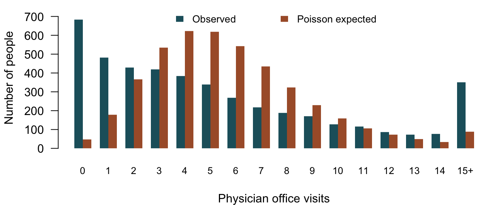

# Fitting Negative Binomial and Zero-Inflated Models in R

## 1 Introduction

In Poisson regression, the mean and variance are equal for a given set
of predictors. People with similar characteristics may still have very
different numbers of doctor visits. The Poisson model may also predict
too few people with no visits. Negative binomial (NB) regression allows
a larger variance. In a zero-inflated negative binomial (ZINB) model, a
zero can come from two sources. One is the NB count model. The other is
the structural-zero component.

The R package **nbzinbJia** fits both models by maximum likelihood.
First, compare the estimates with the reference R functions. Then use
simulated data to check bias, standard errors, and coverage. Finally,
fit both models to the number of physician office visits in the 1987–88
National Medical Expenditure Survey.

## 2 Methods

### 2.1 Negative binomial regression

For observation $`i`$, let $`x_i`$ be the count predictor vector and
$`o_i`$ an optional offset. Write
$`\eta_i=\log\mu_i=x_i^\top\beta+o_i`$. The NB2 model has mean $`\mu_i`$
and variance $`\mu_i+\mu_i^2/\theta`$, where $`\theta>0`$. As $`\theta`$
increases, the variance approaches $`\mu_i`$. The probability mass
function is

``` math
f_{\mathrm{NB}}(y_i;\mu_i,\theta)=
\frac{\Gamma(y_i+\theta)}{\Gamma(\theta)y_i!}
\left(\frac{\theta}{\theta+\mu_i}\right)^\theta
\left(\frac{\mu_i}{\theta+\mu_i}\right)^{y_i}.
```

Let $`a_i`$ be the prior weight for observation $`i`$. For an unweighted
fit, set $`a_i=1`$. The weighted log likelihood is
$`\ell_{\mathrm{NB}}=\sum_i a_i\log f_{\mathrm{NB}}(y_i;\mu_i,\theta)`$.
For fixed $`\theta`$, use Fisher scoring to update $`\beta`$. The
resulting iteratively reweighted least squares (IRLS) step has working
weight $`w_i`$ and offset-adjusted working response $`r_i`$ given by

``` math
w_i=a_i\frac{\theta\mu_i}{\theta+\mu_i},\qquad
r_i=\eta_i-o_i+\frac{y_i-\mu_i}{\mu_i}.
```

Let $`W=\operatorname{diag}(w_i)`$. Solve
$`X^\top W X\,\beta_{\mathrm{new}}=X^\top W r`$ by QR decomposition of
the weighted design. If a proposed step lowers the log likelihood, the
routine can halve the step.

For fixed $`\beta`$, let $`U=\partial\ell_{\mathrm{NB}}/\partial\theta`$
and $`H=\partial^2\ell_{\mathrm{NB}}/\partial\theta^2`$. The score and
curvature for the Newton–Raphson update are

``` math
\begin{aligned}
U &= \sum_i a_i\left[\psi(y_i+\theta)-\psi(\theta)+\log\theta+1
-\log(\theta+\mu_i)-\frac{y_i+\theta}{\theta+\mu_i}\right],\\
H &= \sum_i a_i\left[\psi'(y_i+\theta)-\psi'(\theta)+\frac1\theta
-\frac{2}{\theta+\mu_i}+\frac{y_i+\theta}{(\theta+\mu_i)^2}\right].
\end{aligned}
```

Here $`\psi`$ is the digamma function and $`\psi'`$ is the trigamma
function. Let $`\phi=\log\theta`$. By the chain rule, the score is
$`\theta U`$ and the curvature is $`\theta^2 H+\theta U`$. Thus
$`\phi_{\mathrm{new}}=\phi-\theta U/(\theta^2H+\theta U)`$, and
$`\theta=\exp(\phi)`$ stays positive.

Start with a Poisson IRLS fit for $`\beta`$. Use
$`\sum_i a_i/\sum_i a_i(y_i/\mu_i-1)^2`$ as the initial dispersion,
restricted to a finite range. Alternate the two updates. With the
default controls, stop when the absolute change in the log likelihood is
less than $`10^{-8}`$ or when the iteration limit is reached. Use the
final weights to estimate $`\operatorname{Var}(\hat\beta)`$ by
$`(X^\top \hat W X)^{-1}`$. The standard error of $`\hat\theta`$ is
$`(-H)^{-1/2}`$ at the fit.

### 2.2 Zero-inflated negative binomial regression

Let $`D_i=1`$ indicate membership in the structural-zero component. Its
probability is
$`\pi_i=P(D_i=1)=\operatorname{logit}^{-1}(z_i^\top\gamma)`$ for
zero-part predictors $`z_i`$. The NB component retains the log mean
model above. The probability and mean under the mixture are

``` math
P(Y_i=y_i)=\pi_i\,1(y_i=0)+(1-\pi_i)f_{\mathrm{NB}}(y_i;\mu_i,\theta),
\qquad E[Y_i]=(1-\pi_i)\mu_i.
```

The observed-data log likelihood is $`\sum_i a_i \log P(Y_i=y_i)`$. When
$`y_i=0`$, the log likelihood contains a sum inside the logarithm that
depends on both sets of predictors. Use expectation–maximization (EM) to
update the two components.

1.  **E-step.** If $`y_i=0`$, compute the probability of structural-zero
    membership given the observed count,
    $`\tau_i=\pi_i/[\pi_i+(1-\pi_i)f_{\mathrm{NB}}(0;\mu_i,\theta)]`$.
    Set $`\tau_i=0`$ for a positive count. The probability for a zero
    uses
    $`f_{\mathrm{NB}}(0;\mu_i,\theta)=(\theta/(\theta+\mu_i))^\theta`$.
2.  **Zero-part M-step.** Fit a logistic model to the fractional
    responses $`\tau_i`$ using IRLS. Its working weight is
    $`a_i\pi_i(1-\pi_i)`$, and its working response is
    $`z_i^\top\gamma+(\tau_i-\pi_i)/[\pi_i(1-\pi_i)]`$.
3.  **Count-part M-step.** Refit the NB model using weights
    $`a_i(1-\tau_i)`$. A positive count keeps its original weight
    $`a_i`$. An observed zero receives less weight as $`\tau_i`$
    increases.

Start with the NB fit for the count parameters. For $`\gamma`$, start
with a logistic IRLS fit to $`1(y_i=0)`$. Record the observed log
likelihood at each EM iteration and flag a decrease beyond numerical
tolerance. By default, stop when the absolute change in the observed log
likelihood is less than $`10^{-10}`$ or when the iteration limit is
reached.

### 2.3 ZINB standard errors

Let $`p=(\beta^\top,\gamma^\top,\phi)^\top`$ and
$`g_i=\log f_{\mathrm{NB}}(y_i;\mu_i,\theta)`$. Before applying the
weight $`a_i`$, the score for observation $`i`$ is

``` math
\nabla_p\ell_i =
\begin{pmatrix}
(1-\tau_i)(\partial g_i/\partial\eta_i)x_i\\
(\tau_i-\pi_i)z_i\\
(1-\tau_i)\partial g_i/\partial\phi
\end{pmatrix}.
```

Differentiate the score to obtain the analytic Hessian. For the count
and zero linear predictors, the mixed derivative is
$`-\tau_i(1-\tau_i)\,\partial g_i/\partial\eta_i`$. This contributes to
the off-diagonal block for $`\beta`$ and $`\gamma`$. Evaluate the
Hessian at the fit. The estimated covariance matrix is
$`\widehat{\operatorname{Var}}(\hat p)=
\{-\nabla^2_p\ell(\hat p)\}^{-1}`$. Take the square root of the
corresponding diagonal entry for $`\operatorname{SE}(\hat\phi)`$. By the
delta method, $`\operatorname{SE}(\hat\theta)=
\hat\theta\,\operatorname{SE}(\hat\phi)`$. A package test compares the
analytic Hessian with a numerically differentiated Hessian. The fitting
routines implement the weighted least-squares, Newton–Raphson, and EM
updates directly.

## 3 The R package

Use
[`nbreg()`](https://asahicn00.github.io/nbzinbJia/reference/nbreg.md)
for NB and
[`zinbreg()`](https://asahicn00.github.io/nbzinbJia/reference/zinbreg.md)
for ZINB. In a ZINB formula `y ~ count_terms | zero_terms`, the first
set of predictors goes in the count model and the second set goes in the
zero model. A one-part formula uses the same predictors in both models.
Both fitters accept weights and offsets. Use
[`nbreg_control()`](https://asahicn00.github.io/nbzinbJia/reference/nbreg_control.md)
or
[`zinbreg_control()`](https://asahicn00.github.io/nbzinbJia/reference/zinbreg_control.md)
to set the tolerance, iteration limit, and tracing.

The S3 fit objects work with
[`print()`](https://rdrr.io/r/base/print.html),
[`summary()`](https://rdrr.io/r/base/summary.html),
[`coef()`](https://rdrr.io/r/stats/coef.html),
[`vcov()`](https://rdrr.io/r/stats/vcov.html),
[`logLik()`](https://rdrr.io/r/stats/logLik.html),
[`fitted()`](https://rdrr.io/r/stats/fitted.values.html),
[`residuals()`](https://rdrr.io/r/stats/residuals.html),
[`nobs()`](https://rdrr.io/r/stats/nobs.html), and
[`predict()`](https://rdrr.io/r/stats/predict.html). For
[`AIC()`](https://rdrr.io/r/stats/AIC.html) and
[`BIC()`](https://rdrr.io/r/stats/AIC.html), the parameter count from
[`logLik()`](https://rdrr.io/r/stats/logLik.html) includes the
dispersion parameter. For a ZINB fit, the prediction types `"response"`,
`"count"`, and `"zero"` return $`(1-\pi_i)\mu_i`$, $`\mu_i`$, and
$`\pi_i`$, respectively. The `"prob"` type returns the probability of
specified observed counts.

\
`devtools``::`[`install_github`](https://devtools.r-lib.org/reference/install-deprecated.html)`(``"AsahiCN00/nbzinbJia"``)`\
[`library`](https://rdrr.io/r/base/library.html)`(`[`nbzinbJia`](https://asahicn00.github.io/nbzinbJia/)`)`\
[`data`](https://rdrr.io/r/utils/data.html)`(``"bioChemists"``, package ``=`` ``"pscl"``)`\
\
`m`` ``<-`` `[`zinbreg`](https://asahicn00.github.io/nbzinbJia/reference/zinbreg.md)`(``art`` ``~`` ``fem`` ``+`` ``mar`` ``+`` ``kid5`` ``+`` ``phd`` ``+`` ``ment`` ``|`` ``ment``,`\
`             data ``=`` ``bioChemists``)`\
[`summary`](https://rdrr.io/r/base/summary.html)`(``m``)`\
[`predict`](https://rdrr.io/r/stats/predict.html)`(``m``, newdata ``=`` ``bioChemists``[``1``:``3``, ``]``, type ``=`` ``"response"``)`

The help files give runnable examples. The tests compare the package
with the reference fitters and check offsets, weights, predictions, and
invalid inputs. They also cover nonconvergence and fits near the Poisson
or no-zero-inflation boundaries.

## 4 Benchmarking

Fit both models to
[`pscl::bioChemists`](https://rdrr.io/pkg/pscl/man/bioChemists.html) and
[`AER::NMES1988`](https://rdrr.io/pkg/AER/man/NMES1988.html). For
`bioChemists`, use gender, marital status, young children, PhD prestige,
and mentor productivity in the count and zero models. The `NMES1988`
predictors are listed in the data analysis. Use
[`MASS::glm.nb()`](https://rdrr.io/pkg/MASS/man/glm.nb.html) as the NB
reference, with tolerance $`10^{-10}`$. Use
`pscl::zeroinfl(dist = "negbin")` as the ZINB reference, with relative
tolerance $`10^{-12}`$. The appendix gives the estimates and standard
errors side by side.

| Data        | Model | Coefficients | SEs      | Dispersion | LogLik   | Passed |
|:------------|:------|:-------------|:---------|:-----------|:---------|:-------|
| bioChemists | NB    | 3.01e-08     | 3.17e-10 | 1.18e-08   | 2.96e-12 | 4/4    |
| bioChemists | ZINB  | 1.46e-05     | 8.53e-06 | 1.21e-06   | 4.14e-10 | 4/4    |
| NMES1988    | NB    | 4.76e-08     | 1.42e-10 | 1.15e-09   | 6.73e-11 | 4/4    |
| NMES1988    | ZINB  | 5.40e-06     | 2.95e-06 | 8.67e-07   | 1.07e-09 | 4/4    |

Table 1: Maximum absolute differences between package and reference
fits.

Use $`\theta`$ for NB and $`\log\theta`$ for ZINB. For NB, the
tolerances are $`10^{-5}`$ for coefficients and standard errors and
$`10^{-4}`$ for dispersion and log likelihood. For ZINB, the tolerance
is $`10^{-3}`$ for each quantity. Every difference in
[Table 1](#tbl-agreement) is within tolerance. For ZINB, subtracting the
reference log likelihood from the package log likelihood gives -4.14e-10
on `bioChemists` and 1.07e-09 on `NMES1988`.

| Data        | nbreg | glm.nb | zinbreg | zeroinfl | Repeats |
|:------------|------:|-------:|--------:|---------:|--------:|
| bioChemists | 0.010 |  0.022 |   0.891 |    0.054 |      10 |
| NMES1988    | 0.038 |  0.082 |   6.171 |    0.254 |       3 |

Table 2: Median elapsed time in seconds per fit. Repeats are per fitter.

In [Table 2](#tbl-timing),
[`nbreg()`](https://asahicn00.github.io/nbzinbJia/reference/nbreg.md)
was faster than `glm.nb()` on both datasets.
[`zinbreg()`](https://asahicn00.github.io/nbzinbJia/reference/zinbreg.md)
was slower than `zeroinfl()`. On `NMES1988`,
[`zinbreg()`](https://asahicn00.github.io/nbzinbJia/reference/zinbreg.md)
used 66 EM iterations. Each iteration updates the count and zero models.
The times can vary across computers and software versions.

The tables use the results saved by the scripts in `inst/benchmark/`. To
repeat both studies during rendering, set `-P rerun_studies:true`. The
scripts then run in temporary directories with the installed package.

## 5 Simulation study

Set the seed to 651 and generate 200 independent samples with $`n=500`$.
Use $`x_1\sim N(0,1)`$ and $`x_2\sim\operatorname{Bernoulli}(0.5)`$ in
the count model. Use a separate $`z_1\sim N(0,1)`$ and the same $`x_2`$
in the zero model. With the intercept first, set
$`\beta=(0.8, 0.5, -0.6)`$ and $`\gamma=(-1, 0.7, 0.5)`$, with
$`\theta=1.5`$. Draw $`D_i\sim\operatorname{Bernoulli}(\pi_i)`$ using
the true coefficients. If $`D_i=1`$, set $`Y_i=0`$. Otherwise, draw
$`Y_i`$ from the NB component.

| Parameter       | Truth  | Bias   | Mean SE | MC SD | Coverage |
|:----------------|:-------|:-------|:--------|:------|:---------|
| Count intercept | 0.800  | -0.008 | 0.110   | 0.115 | 94.5%    |
| Count x1        | 0.500  | 0.009  | 0.069   | 0.071 | 94.0%    |
| Count x2        | -0.600 | -0.021 | 0.156   | 0.153 | 97.0%    |
| Zero intercept  | -1.000 | -0.134 | 0.436   | 0.569 | 93.0%    |
| Zero z1         | 0.700  | 0.083  | 0.252   | 0.279 | 95.5%    |
| Zero x2         | 0.500  | 0.004  | 0.407   | 0.419 | 97.5%    |
| Log theta       | 0.405  | 0.018  | 0.292   | 0.316 | 89.5%    |

Table 3: Simulation bias, estimated standard errors, Monte Carlo SD, and
95% Wald interval coverage.

All 200 fits converged, and 0 fits gave warnings. The median number of
EM iterations was 129.5. For the count coefficients, the largest
absolute bias was 0.021. Their mean estimated standard errors were close
to their Monte Carlo standard deviations. The zero intercept had the
largest absolute bias. Its mean estimated standard error was 0.436,
compared with a Monte Carlo standard deviation of 0.569.

For $`\log\theta`$, the 95% Wald interval covered the true value in
89.5% of samples. If the true coverage were 95%, the Monte Carlo
standard error would be about 1.5 percentage points. This result
suggests that the Wald interval for $`\log\theta`$ may be too narrow in
this simulation.

## 6 Physician office visits in NMES1988

Here $`Y`$ is the number of physician office visits for each of 4,406
adults aged 66 or older. Fit Poisson, NB, and ZINB models with hospital
stays, self-rated health, number of chronic conditions, gender, years of
schooling, and private insurance as count predictors. For the ZINB zero
model, use hospital stays, chronic conditions, gender, schooling, and
insurance.

### 6.1 Dispersion, zeros, and fit

The sample mean is 5.77 and the sample variance is 45.69. Thus the
variance is about 7.9 times the mean. There are 683 people with no
recorded visits (15.5%). A Poisson model with mean $`\bar y`$ gives a
zero probability of 0.3%. After including the count predictors, the
expected number of zeros is still only 46.7. This is evidence of poor
fit for Poisson regression.

[Figure 1](#fig-visits) compares the observed and fitted Poisson
frequencies. The last category includes all counts of 15 or more.



Figure 1: Observed visit frequencies and the fitted Poisson frequencies
in NMES1988.

| Model   |  df |   LogLik |     AIC |     BIC | Expected zeros |
|:--------|----:|---------:|--------:|--------:|---------------:|
| Poisson |   8 | -17971.6 | 35959.2 | 36010.4 |           46.7 |
| NB      |   9 | -12170.6 | 24359.1 | 24416.6 |          608.0 |
| ZINB    |  15 | -12090.7 | 24211.4 | 24307.3 |          708.8 |

Table 4: Fit statistics and expected zero counts. Observed zeros: 683

For each fit, add $`P(Y_i=0)`$ across individuals to get the expected
zero count. From [Table 4](#tbl-models), NB with $`\hat\theta=1.21`$
predicts about 75 fewer zeros than observed. ZINB predicts about 26 more
zeros than observed. The ZINB fit is closer to the observed count. Its
AIC is 147.7 points lower than the NB AIC, and its BIC is 109.3 points
lower.

### 6.2 Estimated associations

| Predictor                   | NB IRR (95% CI)   | ZINB count IRR (95% CI) |
|:----------------------------|:------------------|:------------------------|
| Hospital stays              | 1.24 (1.20, 1.29) | 1.22 (1.18, 1.27)       |
| Poor vs average health      | 1.36 (1.23, 1.49) | 1.33 (1.22, 1.45)       |
| Excellent vs average health | 0.71 (0.63, 0.80) | 0.73 (0.65, 0.82)       |
| Chronic conditions          | 1.19 (1.16, 1.22) | 1.14 (1.11, 1.16)       |
| Men vs women                | 0.88 (0.83, 0.94) | 0.92 (0.87, 0.98)       |
| Years of schooling          | 1.03 (1.02, 1.04) | 1.02 (1.01, 1.03)       |
| Private insurance           | 1.25 (1.16, 1.35) | 1.13 (1.05, 1.23)       |

Table 5: Count-model incidence rate ratios and 95% Wald intervals.

**Count model.** Keep the other count predictors fixed. In the NB
component of the ZINB model, one more hospital stay is associated with
about 22% more expected visits (IRR and 95% CI 1.22 (1.18, 1.27)).
People in poor health have about 33% more expected visits than people in
average health (IRR and 95% CI 1.33 (1.22, 1.45)). The insurance IRR is
smaller in the ZINB count model than in NB ([Table 5](#tbl-count)).
Insurance is also in the ZINB zero model. Both coefficients affect the
expected number of visits in the full model.

| Predictor          | OR (95% CI)       |
|:-------------------|:------------------|
| Hospital stays     | 0.45 (0.20, 1.02) |
| Chronic conditions | 0.29 (0.20, 0.41) |
| Men vs women       | 1.91 (1.29, 2.83) |
| Years of schooling | 0.92 (0.87, 0.97) |
| Private insurance  | 0.31 (0.20, 0.48) |

Table 6: Odds ratios for membership in the ZINB structural-zero
component and 95% Wald intervals.

**Zero model.** With the other predictors held fixed, the OR for private
insurance is 0.31 (0.20, 0.48). The OR for one additional chronic
condition is 0.29 (0.20, 0.41). Both are below one. This means lower
odds of being a structural zero. The estimated odds are higher for men
than for women. They are lower for each additional year of schooling.
For hospital stays, the 95% CI includes one ([Table 6](#tbl-zero)). The
model estimates who is likely to be in the structural-zero group because
group membership is unobserved.

## 7 Discussion

**Model choice.** ZINB fits `NMES1988` better by these measures. It has
lower AIC and BIC, and it predicts a number of zeros closer to the
observed number. Private insurance is associated with a higher mean in
the count model and lower odds in the zero model. These comparisons use
the same data as the model fits. To compare prediction accuracy, use a
separate sample.

**Limitations.** The fits agree with the reference functions for the two
datasets in this report. If the zero-part probabilities are close to
zero, it is difficult to estimate the zero-part coefficients. The
information matrix may also be unstable. In the simulation, the Wald
intervals for $`\log\theta`$ covered the true value less often than
expected.

**Possible extensions.** Try different starting values and different
predictors in the zero model. Repeat the simulation with other sample
sizes and levels of zero inflation. The analytic derivatives may also
help speed up fitting. For each proposed update, check that the observed
log likelihood increases or stays the same.

## 8 AI-use statement

I first asked Claude Code to complete the whole project in one pass to
see what it would produce. I then followed the setup guide and prompted
it one step at a time for the fitting code, tests, benchmarks, and
documentation.

I asked Claude Code to check whether comments linked each estimation
block to its formula or explained its numerical choices. It found five
gaps in `nbreg.R` covering the bounds on the initial $`\theta`$, the
outer and inner stopping rules, the Newton step cap, and the Poisson
start $`\mu=y+0.1`$. The
[`nbreg_control()`](https://asahicn00.github.io/nbzinbJia/reference/nbreg_control.md)
example also incorrectly required `pscl`. Claude Code added the missing
comments and fixed the example.

On `bioChemists`, Claude Code tightened the ZINB tolerance from
$`10^{-8}`$ to $`10^{-10}`$. The largest coefficient difference versus
`zeroinfl()` fell from about $`1.5\times10^{-4}`$ to about $`10^{-5}`$.
Profiling showed that
[`dnbinom()`](https://rdrr.io/r/stats/NegBinomial.html) and
[`ifelse()`](https://rdrr.io/r/base/ifelse.html) took most of the time.
Claude Code used the likelihood kernel for coefficient updates and
replaced [`ifelse()`](https://rdrr.io/r/base/ifelse.html) with
vectorized assignment. The inner loop hit its limit because the
tolerance was below floating-point resolution, so Claude Code let it
stop when the parameters stopped changing.

Claude Code tried an explicit
[`lgamma()`](https://rdrr.io/r/base/Special.html) formula for the full
likelihood. Cancellation at large $`\theta`$ caused a near-Poisson test
to fail, so it restored
[`dnbinom()`](https://rdrr.io/r/stats/NegBinomial.html). It also added a
warning when $`\pi`$ was close to zero. A fresh R session showed that
`devtools` 2.5.0 needed `remotes` for `install_github()`, so it updated
the README.

I used OpenAI Codex to draft and revise the report in my Module 2
homework style, rerun the benchmark and simulation, and check the PDF.

## References

- Deb, P., and Trivedi, P. K. (1997). Demand for medical care by the
  elderly: A finite mixture approach. *Journal of Applied Econometrics*,
  12(3), 313–336.
- Dempster, A. P., Laird, N. M., and Rubin, D. B. (1977). Maximum
  likelihood from incomplete data via the EM algorithm. *Journal of the
  Royal Statistical Society, Series B*, 39(1), 1–38.
- Venables, W. N., and Ripley, B. D. (2002). *Modern Applied Statistics
  with S* (4th ed.). Springer.
- Zeileis, A., Kleiber, C., and Jackman, S. (2008). Regression models
  for count data in R. *Journal of Statistical Software*, 27(8), 1–25.

## Appendix. Paired reference estimates

The absolute differences are computed from the unrounded fits. NB
dispersion is shown as theta, and ZINB dispersion is shown as log theta.
The reference is `glm.nb()` for NB and `zeroinfl()` for ZINB.

### bioChemists (NB)

| Term          | Estimate | Reference | Abs. diff. | SE      | Ref. SE | Abs. diff. SE |
|:--------------|:---------|:----------|:-----------|:--------|:--------|:--------------|
| `(Intercept)` | 0.25614  | 0.25614   | 3.01e-08   | 0.13735 | 0.13735 | 3.17e-10      |
| `femWomen`    | -0.21642 | -0.21642  | 5.83e-09   | 0.07264 | 0.07264 | 1.04e-10      |
| `marMarried`  | 0.15049  | 0.15049   | 3.79e-09   | 0.08210 | 0.08210 | 1.60e-10      |
| `kid5`        | -0.17642 | -0.17642  | 7.04e-09   | 0.05281 | 0.05281 | 1.91e-11      |
| `phd`         | 0.01527  | 0.01527   | 7.76e-10   | 0.03587 | 0.03587 | 5.32e-11      |
| `ment`        | 0.02908  | 0.02908   | 2.63e-09   | 0.00321 | 0.00321 | 2.38e-11      |
| `theta`       | 2.26439  | 2.26439   | 1.18e-08   | 0.27118 | 0.27118 | 1.13e-06      |

### bioChemists (ZINB)

| Term | Estimate | Reference | Abs. diff. | SE | Ref. SE | Abs. diff. SE |
|:---|:---|:---|:---|:---|:---|:---|
| `count_(Intercept)` | 0.41675 | 0.41675 | 2.67e-07 | 0.14360 | 0.14360 | 3.34e-07 |
| `count_femWomen` | -0.19551 | -0.19551 | 2.33e-07 | 0.07559 | 0.07559 | 1.34e-08 |
| `count_marMarried` | 0.09758 | 0.09758 | 1.16e-07 | 0.08445 | 0.08445 | 5.15e-09 |
| `count_kid5` | -0.15173 | -0.15173 | 1.70e-07 | 0.05421 | 0.05421 | 7.44e-09 |
| `count_phd` | -0.00070 | -0.00070 | 5.12e-08 | 0.03627 | 0.03627 | 8.10e-08 |
| `count_ment` | 0.02479 | 0.02479 | 3.23e-08 | 0.00349 | 0.00349 | 2.46e-07 |
| `zero_(Intercept)` | -0.19170 | -0.19169 | 1.31e-05 | 1.32281 | 1.32282 | 7.50e-06 |
| `zero_femWomen` | 0.63593 | 0.63593 | 7.76e-07 | 0.84891 | 0.84892 | 6.55e-06 |
| `zero_marMarried` | -1.49945 | -1.49947 | 1.46e-05 | 0.93866 | 0.93867 | 8.53e-06 |
| `zero_kid5` | 0.62843 | 0.62843 | 1.91e-06 | 0.44278 | 0.44278 | 2.45e-06 |
| `zero_phd` | -0.03771 | -0.03771 | 2.73e-06 | 0.30801 | 0.30801 | 1.71e-06 |
| `zero_ment` | -0.88229 | -0.88229 | 7.44e-06 | 0.31622 | 0.31623 | 3.99e-06 |
| `log(theta)` | 0.97636 | 0.97636 | 1.21e-06 | 0.13547 | 0.13547 | 1.45e-06 |

### NMES1988 (NB)

| Term              | Estimate | Reference | Abs. diff. | SE      | Ref. SE | Abs. diff. SE |
|:------------------|:---------|:----------|:-----------|:--------|:--------|:--------------|
| `(Intercept)`     | 0.92926  | 0.92926   | 4.76e-08   | 0.05459 | 0.05459 | 1.13e-10      |
| `hospital`        | 0.21777  | 0.21777   | 3.58e-08   | 0.02018 | 0.02018 | 6.50e-11      |
| `healthpoor`      | 0.30501  | 0.30501   | 3.15e-08   | 0.04851 | 0.04851 | 7.58e-11      |
| `healthexcellent` | -0.34181 | -0.34181  | 9.05e-09   | 0.06092 | 0.06092 | 1.42e-10      |
| `chronic`         | 0.17492  | 0.17492   | 1.39e-08   | 0.01209 | 0.01209 | 5.59e-13      |
| `gendermale`      | -0.12649 | -0.12649  | 5.74e-09   | 0.03122 | 0.03122 | 4.01e-11      |
| `school`          | 0.02682  | 0.02682   | 6.11e-10   | 0.00439 | 0.00439 | 5.95e-12      |
| `insuranceyes`    | 0.22440  | 0.22440   | 8.16e-09   | 0.03946 | 0.03946 | 6.10e-11      |
| `theta`           | 1.20660  | 1.20660   | 1.15e-09   | 0.03356 | 0.03355 | 4.20e-07      |

### NMES1988 (ZINB)

| Term | Estimate | Reference | Abs. diff. | SE | Ref. SE | Abs. diff. SE |
|:---|:---|:---|:---|:---|:---|:---|
| `count_(Intercept)` | 1.19371 | 1.19371 | 4.59e-07 | 0.05666 | 0.05666 | 1.67e-07 |
| `count_hospital` | 0.20148 | 0.20148 | 2.63e-08 | 0.02036 | 0.02036 | 9.17e-09 |
| `count_healthpoor` | 0.28513 | 0.28513 | 9.00e-08 | 0.04509 | 0.04509 | 1.19e-09 |
| `count_healthexcellent` | -0.31934 | -0.31934 | 2.07e-07 | 0.06040 | 0.06040 | 8.51e-09 |
| `count_chronic` | 0.12900 | 0.12900 | 1.41e-07 | 0.01193 | 0.01193 | 6.55e-09 |
| `count_gendermale` | -0.08028 | -0.08028 | 1.28e-07 | 0.03102 | 0.03102 | 7.04e-09 |
| `count_school` | 0.02142 | 0.02142 | 2.48e-08 | 0.00436 | 0.00436 | 2.00e-08 |
| `count_insuranceyes` | 0.12586 | 0.12586 | 1.92e-07 | 0.04159 | 0.04159 | 1.23e-08 |
| `zero_(Intercept)` | -0.04688 | -0.04688 | 5.40e-06 | 0.26856 | 0.26856 | 2.95e-06 |
| `zero_hospital` | -0.80049 | -0.80048 | 4.60e-06 | 0.42082 | 0.42082 | 1.53e-06 |
| `zero_chronic` | -1.24793 | -1.24794 | 4.50e-06 | 0.17832 | 0.17832 | 3.43e-07 |
| `zero_gendermale` | 0.64768 | 0.64768 | 3.70e-07 | 0.20011 | 0.20011 | 6.81e-07 |
| `zero_school` | -0.08377 | -0.08377 | 6.26e-07 | 0.02625 | 0.02625 | 7.20e-07 |
| `zero_insuranceyes` | -1.17561 | -1.17562 | 4.17e-06 | 0.22012 | 0.22012 | 1.95e-06 |
| `log(theta)` | 0.39414 | 0.39414 | 8.67e-07 | 0.03504 | 0.03504 | 9.58e-08 |
